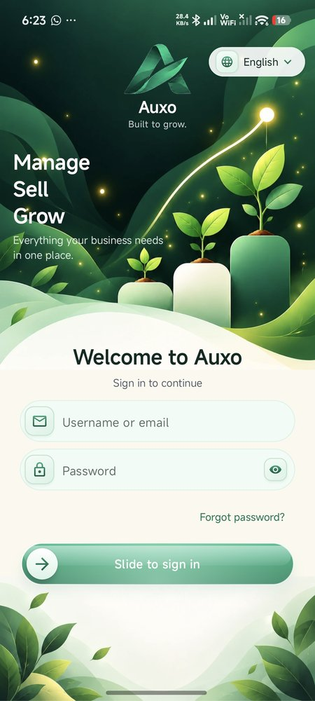
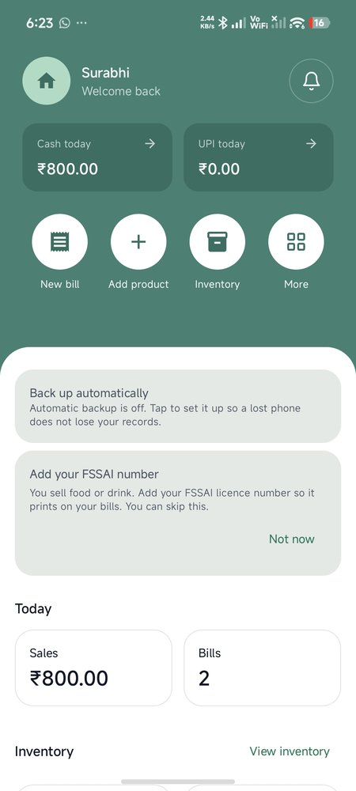
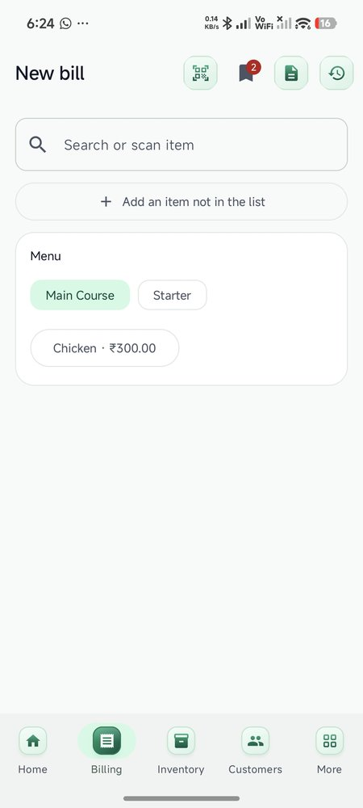
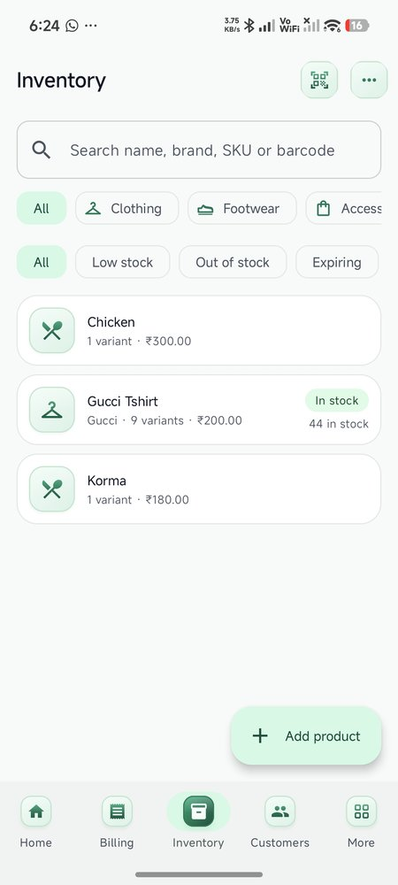
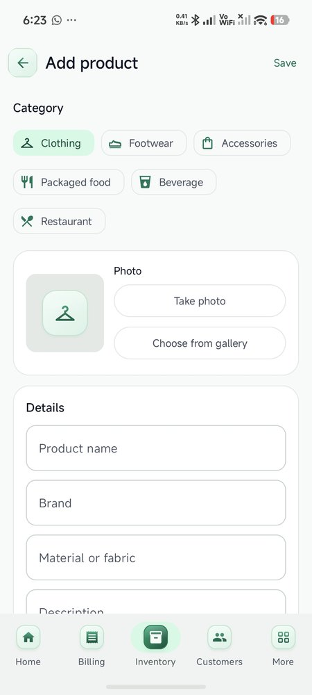
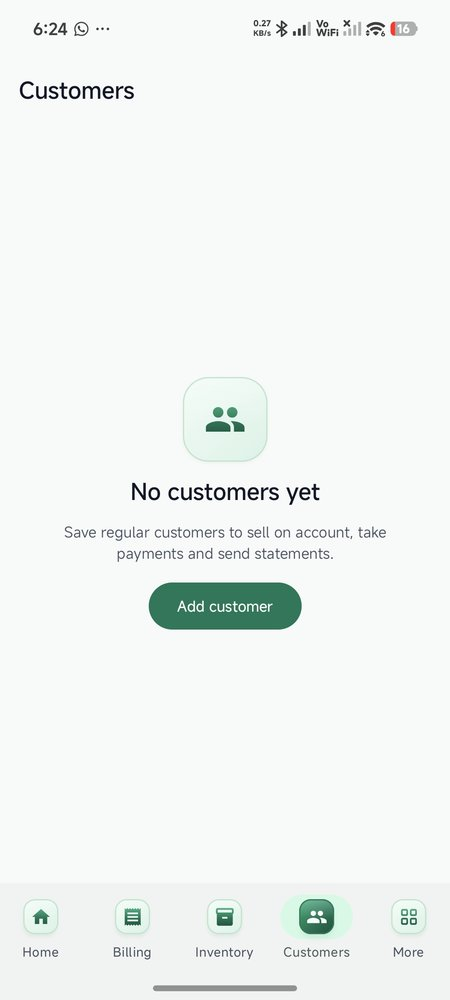
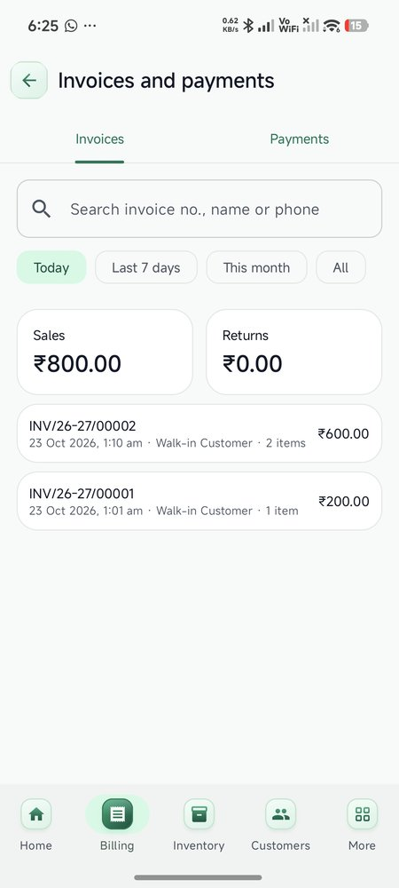
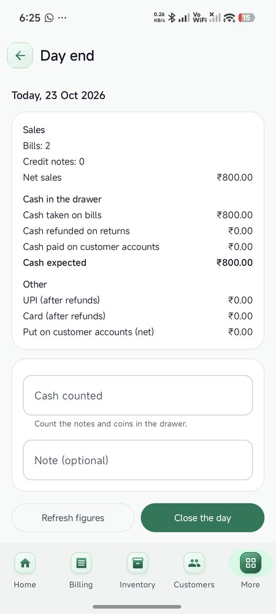
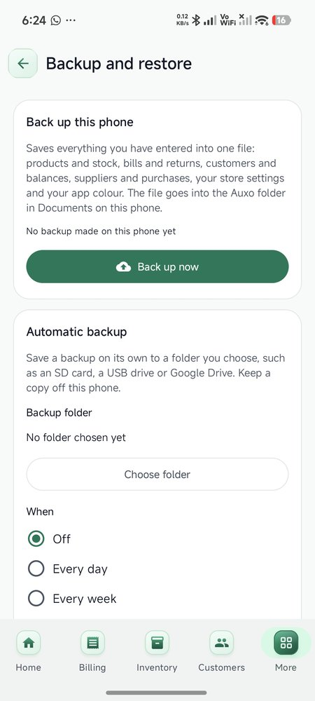

<p align="center">
<picture>
<source media="(prefers-color-scheme: dark)" srcset="design/auxo/auxo-logo-horizontal-dark.png">

</picture>
</p>

<p align="center">


</p>

**Auxo** is a whole shop in your pocket. Bill customers, track stock, keep the books straight and print the receipt, all from one Android app. It works offline, with no server and no monthly fee. The only time it uses the internet is to check for and download app updates. The name comes from the Greek *auxō*, "to increase or grow".

Built for small Indian shops (clothes, packaged food, drinks, cafés). It speaks GST, counts in paise, reads barcodes and works in English, Hindi and Bengali.

## What it does

- **Bill fast.** Scan with the camera or a hardware scanner, split payments across cash, UPI, card and customer accounts, hold a bill and come back to it, send quotations on WhatsApp.
- **GST done right.** CGST/SGST/IGST, HSN codes, the apparel rate rule, invoices numbered per financial year, credit notes for returns.
- **Know your stock.** Sizes and colours, batches with expiry, reorder suggestions, purchase orders, stock counts, CSV import, product photos.
- **Run a restaurant too.** Dishes sit beside your other products, with or without a stock count.
- **See the numbers.** Twelve reports, day-end cash closing, a GST report, CSV export.
- **Stay in control.** Owner and employee logins with per-person permissions, idle lock with PIN or fingerprint, activity log, backup and restore.
- **Print anywhere.** PDF, Android printing, or straight to a Bluetooth receipt printer (58, 76 or 80 mm).

## Screenshots

| Sign in | Home | New bill |
|---|---|---|
|  |  |  |

| Inventory | Add product | Customers |
|---|---|---|
|  |  |  |

| Invoices and payments | Day end | Backup and restore |
|---|---|---|
|  |  |  |

Taken on a real Android phone.

## Brand assets


The approved artwork is in `design/auxo/` (originals: `docs/branding/auxo-logo-reference.png`; the app icon is `docs/branding/auxo-icon-transparent.png`): the full logo, the symbol alone, a vertical logo, a version for dark backgrounds and a grey one. The launcher icon and the sign-in logo are cut from that same artwork by `tools/extract_auxo_logo.py`, nothing is redrawn.
<br clear="left">

## One rule: the books must add up

Money is stored in whole paise, never as decimals. A sale saves the invoice, payments, stock and customer account in a single transaction, so it either all happens or none of it does. Double taps can't save a bill twice. Thousands of random bills in the tests add up to the paisa.

## Install

Download `Auxo-vX.Y.Z.apk` from the [latest release](https://github.com/Roybabu/Auxo/releases/latest) on your phone (Android 8.0 or newer) and open it. Android will ask you to allow installs from your browser or file manager the first time. Later versions are offered inside the app (More → Check for updates) and install over the old one. Google is introducing developer verification for apps on certified phones, so Android may show an extra warning for apps from outside Google Play. The app is signed with the project's own key; the privacy policy is in [docs/PRIVACY.md](docs/PRIVACY.md).

**Publishing a release (maintainers).** Add the secrets `KEYSTORE_BASE64`, `KEYSTORE_PASSWORD`, `KEY_ALIAS` and `KEY_PASSWORD`, raise `versionCode` and `versionName` in `app/build.gradle.kts`, then push a matching tag: `git tag v1.0.0 && git push origin v1.0.0`. The Release workflow builds the signed APK and attaches it with `mapping.txt` (keep it to read crash traces).

## Get started

**You need**
- Git
- JDK 17 or newer (Android Studio includes one)
- Android Studio recent enough for Android Gradle Plugin 9.4
- Android SDK Platform 37 and Build Tools 36.0.0 or newer (install from Android Studio's SDK Manager)
- A phone (Android 8.0+) with USB debugging, or an emulator. Camera scanning needs Google Play services.
- Internet on the first build, so Gradle can download itself and the libraries. The app works offline; it uses the internet only to look for updates (see Privacy and permissions).

**Clone and run**
```bash
git clone https://github.com/Roybabu/Auxo.git
cd Auxo
git checkout -b my-change          # work on your own branch
```
Open the folder in Android Studio, let it sync, pick a device and press Run. If you build from the command line, create `local.properties` with `sdk.dir=/path/to/Android/sdk` (Android Studio does this for you).

**Build and test**
```bash
./gradlew assembleDebug             # APK in app/build/outputs/apk/debug/
./gradlew testDebugUnitTest         # unit, database and screen tests
./gradlew lintDebug                 # Android lint
./gradlew connectedDebugAndroidTest # device tests (phone or emulator)
```
Before you commit, run `python3 .github/scripts/security_check.py` (the same secret and manifest check CI runs). If you change the database, bump the version, add a migration and its test, and commit the new file in `app/schemas`.

Kotlin, Jetpack Compose, Material 3, Room, MVVM. Android 8.0 and newer. CI (`.github/workflows/android-ci.yml`) builds, tests, lints and runs device tests on an emulator.

## Tech stack

| Layer | Used |
|---|---|
| Language | Kotlin |
| UI | Jetpack Compose, Material 3, Navigation Compose |
| Architecture | MVVM, with plain-Kotlin domain logic |
| Database | Room (SQLite) locked with SQLCipher, with exported schemas |
| Barcodes | Camera and hardware scanners, ZXing |
| Printing | PDF, Android printing, Bluetooth receipt printers |
| Languages | English, Hindi, Bengali |
| CI | GitHub Actions: build, unit tests, lint, security check, emulator tests |

## Where things live

```
app/src/main/java/com/auxo/pos/
├── core/       sign-in, backup, printing, receipts, photos, DI
├── data/       Room database, repositories, permission checks
├── domain/     billing, GST, inventory, reports (plain Kotlin)
├── viewmodel/  screen state
└── ui/         Compose screens and navigation
```

## Crash and problem reports

If the app crashes, it saves a short report on the phone and offers, the next time you open it, to share it. **More → Send a diagnostic report** makes one on demand. Nothing is sent unless you choose to. A report holds the app and phone version, the error and where it happened, and the names of the last screens opened. It holds no customer, sales or shop details, and database keys, email addresses and long numbers are removed. You can share the file with the developer, or use **Report on GitHub**, which opens a new issue on this repository: anything you paste there is public.

## Database upgrades

The database starts at version 1, the first released version, and nothing older is supported. A test phone that still holds an older database should be uninstalled and reinstalled. From the next version on, every database change needs a migration, its test and its exported schema in `app/schemas`.

## Privacy and permissions

The full policy is in [docs/PRIVACY.md](docs/PRIVACY.md).

Your shop's data (products, bills, customers, settings) stays on the device. The app has no server and no account, and it sends none of that data anywhere. The only thing it does over the network is update itself:

- **Update check.** When the app opens, and when you tap Check for updates, it asks GitHub (`api.github.com`, the project's latest release) whether a newer version exists. The request carries no shop data. If one exists it offers to download it. Downloading and installing only happen when you tap them.
- **Install permission.** To install a downloaded update, Android asks you to allow Auxo to install apps. This is the `REQUEST_INSTALL_PACKAGES` permission, used only for updates.

Permissions the app declares:

| Permission | Why |
| --- | --- |
| Internet | Check for and download app updates (above). Nothing else. |
| Install unknown apps | Install a downloaded update, after you allow it. |
| Bluetooth (connect) | Print receipts on a paired Bluetooth printer. No scanning and no location. |
| Storage (Android 9 and older only) | Save backups in Documents/Auxo, where they survive uninstalling the app. |

Things that happen outside the app's own network use: sending a customer a reminder opens WhatsApp or the messages app, which then does its own sending, and the barcode scanner is Google Play services' scanner, which Google may download once.

## License

Auxo is free software under the [GNU General Public License v3.0](LICENSE) (GPL-3.0-or-later). You can use, study, change and share it. If you distribute a modified version, you must share its source code under the same license.

The name **Auxo**, its logo and its artwork are not covered by that license. Forks may reuse the code but not the name or the logo.
